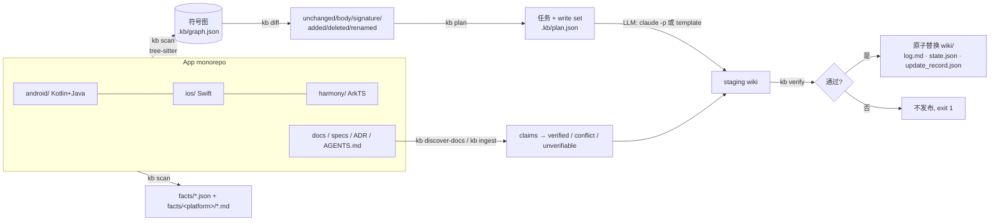

# codewiki — 把三端代码 compound 成可被验证的 LLM Wiki

`codewiki` 是一个 Go CLI（`kb`）加一组 Claude Code skills：它把一个移动端 monorepo 的代码（Android Kotlin/Java、iOS Swift、HarmonyOS ArkTS，另有 JS/TS 支持）和旧文档/规格 **compound**（持续复利式沉淀）成 agent 友好的 LLM Wiki。每次 merge 到 master 都增量更新，而且**知识必须可证明地与当前代码一致**：每个页面通过锚点（符号 ID + 内容 hash）绑定代码，CI 中 `kb verify` 不通过就不发布。

> 设计取向：**确定性交给 CLI，理解交给 LLM，一致性靠硬校验。**

## 为什么

- 代码库的“知识”散落在代码、过时的 wiki、口口相传里；LLM 每次从零读仓库既贵又不稳定。
- 纯 LLM 生成的 wiki 会漂移：代码改了文档没改，没人知道哪页过时。
- codewiki 让 LLM 只写 prose，事实（路由、深链、testID、接口、符号）由 tree-sitter 确定性抽取；页面锚定符号 hash，任何代码变化都能精确定位到受影响页面，并且只重写这些页面。

## 架构



```
            ┌──────────── kb compound ────────────────────────────────────────┐
 merge ──▶  │ scan ─▶ diff ─▶ plan ─▶ LLM(写集受限) ─▶ verify(staging) ─▶ publish │ ─▶ wiki/
            └─────────────────────────────────────────────────────────────────┘
```

| 层 | 负责 | 产出 |
|---|---|---|
| 事实层 | Go CLI（tree-sitter，确定性） | `facts/{android,ios,harmony}/*.md`、`facts/routes.json`、`testids.json`、`apis.json`、`requirements.json` |
| 理解层 | LLM（`kb-compound` skill，或离线 template writer） | `pages/features/*`、`pages/overview.md`、`pages/_conflicts.md` … |
| 校验层 | `kb verify`（CI 门禁） | 锚点 hash 全部匹配 HEAD、符号存在、无死链、无孤儿页、index 覆盖、facts 新鲜 |

## 安装

需要 Go 1.24 与 C 编译器（tree-sitter 语法通过 cgo 编译）。

```bash
go install github.com/luckylucky0001/codewiki/cmd/kb@latest
# 或从 checkout 构建
git clone https://github.com/luckylucky0001/codewiki && cd codewiki && go build -o kb ./cmd/kb
```

ArkTS 语法以源码形式 vendored 在模块内部（`internal/grammars/arkts`，含 MIT LICENSE 与 VENDORED.md），`go.mod` 不含任何 `replace`，因此远程 `go install …@latest` 可用。

提示：Swift 语法的 C 代码在编译时会打印 `TOKEN_COUNT redefined` 警告，无害；可用 `CGO_CFLAGS="-O2 -w"` 静默。

## 快速开始

```bash
cd your-monorepo                 # 含 android/ ios/ harmony/
kb init                          # 生成 codewiki.yaml、wiki/ 骨架与 wiki/AGENTS.md schema
kb discover-docs --json > /tmp/docs.json
kb ingest --manifest /tmp/docs.json --kinds spec,design,adr,agent-guide,doc   # 文档断言逐条核对
kb compound                      # 首次：全量；之后：增量（默认 template 写作器，离线确定性）
kb compound --llm claude         # 使用真实 LLM（claude -p）写页面
kb verify                        # CI 门禁：exit 0 = wiki 与 HEAD 一致
kb search "购物车 上限"; kb get features/cart; kb context android/.../CartViewModel.kt
```

完整演示：`demo/run.sh`（见 [demo/README.md](demo/README.md)）。PDF 手册：[docs/codewiki-manual.pdf](docs/codewiki-manual.pdf)（源文件 `docs/manual/manual.html`，`docs/build-pdf.sh` 构建）。

## 配置 `codewiki.yaml`

```yaml
version: 1
wiki_dir: wiki
project: minishop
platforms:                       # 平台名会成为符号 ID 的 scheme
  - name: android
    root: android
  - name: ios
    root: ios
  - name: harmony
    root: harmony
  # - name: web                  # JS/TS 仓库（见 axios 案例）
  #   root: .
  #   include: ["lib/**/*.js"]
exclude: ["**/build/**", "**/node_modules/**", "**/Pods/**", "**/oh_modules/**"]
llm:
  cmd: claude -p --permission-mode acceptEdits --allowedTools "Read,Write,Edit,Glob,Grep,Bash(kb anchor:*),Bash(kb get:*),Bash(kb search:*)" --output-format text
  timeout_sec: 600
plan:
  hops: 1                        # 签名变化沿引用边传播的跳数 k
  rebuild_module_ratio: 0.5      # >50% 模块变化 → 全量重建
  rebuild_structural_ratio: 0.3  # >30% 结构变化(增/删/改名/签名) → 全量重建
docs:
  exclude: []
```

`--config <file>` + `--root <repo>` 可以把 wiki 写到仓库之外（只读分析第三方仓库，见 axios 案例）。

## 命令参考

所有命令：`--json`（stdout 输出 JSON）、`--root`、`--config`、`--wiki-dir`（wiki 放在仓库外）、`--quiet`；数据 → stdout，日志 → stderr；退出码 **0** 成功、**1** stale/verify 失败、**2** 用法错误、**3** 内部错误；写入类命令支持 `--dry-run`；从不交互；重复运行幂等：无变化时 compound 为 `noop`，不改页面、不写 log，只把 `last_sha` 推进到 HEAD。

| 命令 | 作用 |
|---|---|
| `kb init [--dry-run]` | 生成 `codewiki.yaml`（自动探测平台目录）、wiki 骨架、`AGENTS.md` schema；不覆盖已有文件 |
| `kb scan [--out graph.json] [--symbols]` | tree-sitter 抽取符号与 facts，报告 `parse_failures` |
| `kb diff [--base <sha>]` | 与上次 compound 的符号图（或 `--base` 版本）按符号 ID 比对：unchanged / body / signature / added / deleted / renamed（含 body 相似度） |
| `kb plan [--base] [--full] [--dry-run]` | 受影响页面 = 自身锚点变化 ∪ 签名变化沿引用边 k 跳传播 ∪ 新路由；每个任务带显式 write set；超阈值全量重建；写 `wiki/.kb/plan.json` |
| `kb compound [--llm template\|claude\|cmd] [--llm-cmd ...] [--fallback] [--max-llm-tasks N] [--full] [--dry-run] [--keep-work]` | scan→diff→plan→LLM→verify→原子发布；更新 `.kb/state.json`（last_sha）、`.kb/update_record.json`、追加 `log.md` |
| `kb verify [--fix-index]` | 锚点 hash 匹配 HEAD、正文提到的符号存在、无死链、无孤儿页、index 覆盖、facts 与重新抽取一致、requirements 锚点新鲜 |
| `kb status` | 列出 stale 页面（exit 1 表示存在） |
| `kb discover-docs [--out f]` | 按业界约定发现并分类文档（spec/design/tasks/adr/agent-guide/readme/doc），记录 path + hash |
| `kb ingest <docs...> \| --manifest f [--kinds ...] [--llm ...] [--dry-run]` | 复制到 `raw/docs/`，抽取断言（EARS、MUST/SHALL、`FR-001`、Kiro 需求编号），逐条核对 → `pages/_conflicts.md` + `facts/requirements.json` |
| `kb search <q>` | 页面 + facts + 符号名检索 |
| `kb get <page-id>` | 输出页面（`features/cart`、`_conflicts`、`facts/ios/routes`） |
| `kb conflicts [--all]` | **哪些文档过时**：列出与代码矛盾的文档断言，带 `文件:行号`、代码证据和修改建议（`--json` 机器可读；`--all` 同时列出无证据的断言）。MCP 工具 `kb_conflicts` |
| `kb context <file>` | 描述某文件的页面、符号、路由/testID/接口，以及锚点落在该文件里的**文档需求/业务规则**（`requirements`：id、text、status、source；template 模式同样有）。改代码或生成测试前给 agent 用 |
| `kb anchor <symbol-id...>` | 打印符号当前 hash（LLM 写 frontmatter 时用） |
| `kb lint-tid [--strict]` | testID 覆盖矩阵：路由 × tid × 平台 |
| `kb parity [--strict]` | 功能 × 平台一致性矩阵：路由 / testID / 可达接口是否齐全，以及同名常量的跨平台取值差异；同时生成 `pages/parity.md` |
| `kb install-skills <repo> [--no-agents-md]` | 把 skills 安装到 `<repo>/.claude/skills/`。同时在 `AGENTS.md` 和 `CLAUDE.md` 中写入或更新一段 `<!-- codewiki:begin -->…<!-- codewiki:end -->` 指引块，把各类问题映射到对应命令：路由/深链 → facts、testID → `kb lint-tid`、三端差异 → `kb parity`、过时文档 → `kb conflicts`、改文件前 → `kb context`。重复运行结果不变，块外内容保持原样 |
| `kb bench [--synthetic N]` | 冷/热扫描基准（合成仓库或 `--root` 指定的真实仓库） |
| `kb eval [--llm …]` | 用人工标注的 golden set 评测断言核对与 plan 影响面（precision/recall） |
| `kb hook install --mode post-receive\|post-merge [--repo <git dir>]` | 安装 git 钩子：服务端 push 到 master 或客户端 merge 后自动 compound（串行 + 追平） |
| `kb mcp` | stdio MCP server（JSON-RPC 2.0），工具：`kb_search`、`kb_get`、`kb_context`、`kb_anchor`、`kb_status`、`kb_parity` |

## Wiki 布局

```
wiki/
  AGENTS.md            # schema：写作规范（frontmatter 契约、写集规则）
  index.md             # 分层目录（kb 维护；kb verify --fix-index）
  log.md               # append-only："## [YYYY-MM-DD] op | subject"
  llms.txt             # 外部 agent 入口
  raw/docs/            # 旧文档/规格原文（只读、低可信）+ manifest.json
  facts/               # 生成文件，禁止手改（头部有 DO NOT EDIT）
    routes.json testids.json apis.json requirements.json
    android/{routes,testids,apis,symbols}.md  ios/…  harmony/…
  pages/
    overview.md        # 三端路由矩阵
    parity.md          # 三端一致性（生成，verify 检查新鲜度）
    features/<route_id>.md
    concepts/navigation.md         # 路由表 / 路由器 / 深链与测试参数
    concepts/shared-components.md  # 被 ≥3 个路由使用的共享符号
    flows/ concepts/ decisions/
    _conflicts.md      # 文档 vs 代码：conflict / verified / unverifiable
  .kb/graph.json       # 符号图快照（增量基准）
  .kb/state.json       # last_sha、graph/prompt 版本、writer
  .kb/plan.json  .kb/update_record.json  .kb/ingest/verdicts.json
```

### 符号模型

- ID：`<platform>://<相对平台根的路径>#<限定名>`，例如 `android://app/src/main/java/com/minishop/ui/login/LoginViewModel.kt#LoginViewModel.login`、`harmony://entry/src/main/ets/pages/ProductDetailPage.ets#ProductDetailBuilder`。同名重载追加 `~2`。
- `hash`：去掉注释、空白归一后的 token 序列的 sha256 → **只改注释/格式 = no-op**；容器（class/struct/component）的 hash 只包含自身头部和成员**签名**，成员函数体变化不会让整个类失效。
- `sig_hash`：声明头（body 之前，含注解/装饰器）的 hash → 区分 body 变化与 signature 变化。
- `refs`：函数体内标识符按简单名称解析到已知符号（同平台，优先同文件、父类型被引用者），作为传播边。
- `norm_hash` + `simhash`：去掉自身名字后的 body 指纹，用于识别 rename（完全相同 → similarity 1.0；同目录 simhash ≥ 0.8 → 模糊 rename）。
- 行号只用于展示，不参与 hash。

### 三端 facts 来源

| | 路由 / 页面 | 深链 | testID | 接口 |
|---|---|---|---|---|
| Android | Compose `composable(Routes.X)` / NavHost（解析 `const val`）、类型安全 `composable<T>` / Navigation 3 `entry<T>`；Manifest activity | Manifest intent-filter `<data android:scheme>` | `Modifier.testTag("x")` | Retrofit、Ktor `client.get`、OkHttp `Request.Builder().url` |
| iOS | `enum Route: String { case productDetail = "product/{id}" }` + `XxxView`；`navigationDestination(for: X.self)` 关联值枚举 | Info.plist `CFBundleURLSchemes` | `.accessibilityIdentifier("x")` | `send(.post, path:)` 封装、Alamofire `AF.request`、Moya / `Endpoint` 枚举 |
| HarmonyOS | `resources/base/profile/router_map.json`（name / pageSourceFile / buildFunction / data.pattern）、`main_pages.json` | `module.json5` skills `uris[].scheme` | `.id('x')`（含 ArkUI 链式属性） | `http.createHttp().request`、`@ohos/axios`、RCP `session.get` / `rcp.Request` |

动态 testID（`"product_item_${p.id}"`）按字面前缀记录（`product_item_`）。字符串拼接、插值、常量引用都会静态求值（未知部分记为 `{name}`）。

### 互通 schema（与 e2epilot 共享，保持不变）

```json
{"version":1,"routes":[{"platform":"android|ios|harmony|web","route_id":"product_detail","pattern":"product/{id}","deeplink":"minishop://product/{id}","file":"...","symbol":"..."}]}
{"version":1,"testids":[{"platform":"...","tid":"add_to_cart","route_id":"product_detail","file":"...","line":12}]}
{"version":1,"apis":[{"platform":"...","method":"POST","path":"/api/login","file":"...","symbol":"..."}]}
{"version":1,"requirements":[{"id":"FR-001","source":"specs/001-cart/spec.md","text":"...","status":"verified","anchors":[{"sym":"...","hash":"..."}],"route_ids":["cart"]}]}
```

`route_id` 为空表示共享组件（如 `nav_back`）。

## Frontmatter 契约

```yaml
---
id: features/cart                 # = 路径去掉 pages/ 和 .md（verify 强制）
title: 购物车（cart）
kind: feature                     # feature | flow | concept | decision | overview | conflicts
platforms: [android, harmony, ios]
routes: [cart]
sources:                          # 锚点：符号 ID + 当前 hash
  - sym: android://app/src/main/java/com/minishop/ui/cart/CartScreen.kt#CartScreen
    hash: 298d51bd…
source_commit: 02b11f8
status: current                   # current | stale | outdated-doc
---
```

规则：锚点 hash 与 HEAD 不符 → `E_ANCHOR_STALE`；符号消失 → `E_ANCHOR_MISSING`；正文反引号里的符号 ID 必须存在 → `E_SYMBOL_UNKNOWN`；`status: stale` 也会让 verify 失败。

## 增量 compound 的细节

1. **diff**：基准是上次成功 compound 的 `.kb/graph.json`（而不是 commit 链），所以 squash/rebase/积压多次 merge 都能一次追到 HEAD；`--base <sha>` 用 `git archive` 重新扫描任意版本。
2. **plan**：
   - 页面自身锚点 body/signature 变化、删除、改名 → 受影响；
   - signature 变化 / 删除 / 改名的符号，沿**反向引用边**走 k 跳（`plan.hops`），锚定到这些调用方的页面也受影响（RepoAgent 式引用失效）；
   - facts 中出现新 `route_id` → `create pages/features/<id>.md`；路由集合变化 → 更新 overview；
   - 模块（含源码的目录）变化比例 > 50% 或结构变化比例 > 30% → 全量重建。
3. **LLM 执行**：CLI 为每个任务写 prompt（任务、write set、相关 facts、符号源码、现有页面或确定性草稿），以 staging wiki 为 cwd、prompt 走 stdin 调用 `--llm-cmd`。执行后对 staging 做快照 diff，**write set 之外的写入全部回滚**并把任务标记为 `violation`（OpenDeepWiki 式受限写集）。随后 CLI 规范化 frontmatter：强制 id/kind/routes，给 prompt 中出现过的符号重盖当前 hash，拒绝未知符号。
4. **template writer**（`--llm template`）：离线、确定性地从 facts + 符号图生成页面（锚点正确），用于无 key 的 CI、可复现的 demo，也是 `--fallback` 的兜底。
5. **verify → publish**：在 staging 上跑完整 verify；通过才把 `wiki/` 原子替换（rename），否则保留 staging（`--keep-work`）并 exit 1。同时写 `.kb/state.json`、`.kb/update_record.json`，追加 `log.md`。运行期间持有 `.kb-work/lock`。

## 锚点精度：功能页 vs 共享组件

功能页只锚定**路由所属的 screen 及其成员、它的 ViewModel / store（名称与路由同前缀，或被 screen 直接引用的页面组件）、以及 2 跳内可达的接口调用**。被 ≥3 个路由（同平台）引用的符号——返回按钮、顶栏、API client、`TokenStore`——归入 `pages/concepts/shared-components.md`；路由表、路由器、导航栈、深链与测试参数处理（名称匹配 route/router/navigation/deeplink/pathStack/testParams）归入 `pages/concepts/navigation.md`。因此修改 `BackButton` 只会让 shared-components 页失效，不会让所有功能页一起 stale（有单测覆盖）。共享容器（struct/class）只按成员签名计算 hash，所以其成员也一并锚定。

## 三端一致性：`kb parity`

`kb parity` 从 facts 与符号图生成功能 × 平台矩阵：

- 每个 `route_id` 在各平台是否有路由；
- testID 是否齐全（以三端并集为准）；
- 从 screen 出发 3 跳内可达的 HTTP 接口是否齐全；
- 同名常量（`MAX_CART_ITEMS` / `maxCartItems` 归一化为 `max_cart_items`）在各平台的取值差异。

结果同时写入 `pages/parity.md`（生成页，`kb verify` 检查其新鲜度）。demo 的变更集 01 故意只改了 Android 和鸿蒙的购物车上限，parity 立即报告：

| 常量 | android | ios | harmony |
|---|---|---|---|
| `max_cart_items` | `50` | `99` | `50` |

`--strict` 在存在差异时 exit 1，可作为 CI 门禁。

## 与 e2epilot 联动

`kb diff --json` 与 `wiki/.kb/plan.json`（`kb plan` / `kb compound` 写入）都暴露：

```json
{
  "changed_route_ids": ["cart", "product_detail"],
  "changed_routes": [
    {"route_id": "cart", "platforms": ["android", "harmony"], "reasons": ["symbol_changed"],
     "symbols": ["android://app/src/main/java/com/minishop/ui/cart/CartViewModel.kt#CartViewModel.MAX_CART_ITEMS"]}
  ],
  "changed_files": ["android/app/src/main/java/com/minishop/ui/cart/CartViewModel.kt", "..."]
}
```

- `changed_route_ids`：受影响路由（去重排序）。路由被判为受影响的条件（`reasons`）：
  - `symbol_changed`：从 screen 出发 3 跳内可达的符号发生了 body / signature / rename / 增删，或功能页锚定的符号发生变化；新旧两张图都会检查；
  - `route_added` / `route_removed` / `route_changed`：与上一次 `facts/routes.json` 对比，路由增删，或 pattern / deeplink / symbol 变化；
  - `testid_changed`：该路由下的 testID 增删。
- `changed_files`：符号图中内容 hash 变化的源文件，加上 `git diff --name-only base head` 的结果（包含 `router_map.json`、`Info.plist` 等资源文件，排除 wiki 目录）。
- 路由 ID 与 `facts/routes.json`、`testids.json`、`requirements.json` 中的 `route_id` 一致。

e2epilot 侧的典型用法：

```bash
ROUTES=$(kb diff --json | jq -r '.changed_route_ids | join(",")')
e2e graph invalidate --changed-routes "$ROUTES"
e2e impact --changed-routes "$ROUTES" --requirements wiki/facts/requirements.json
```

## 增量扫描缓存与性能

`kb` 在 `wiki/.kb/cache/scan.gob.gz` 中按文件保存解析结果（键 = 仓库相对路径 + 内容 sha256 + 语言/平台；缓存版本由抽取器指纹自动派生：`internal/extract` 的 Go 源码通过 `go:embed` 计入 hash，再加上各语言节点表、语法 ABI 版本与 node kind 数量，因此改了抽取器而忘记手动 bump 也不会读到旧缓存），未变化的文件不再调用 tree-sitter；删除的文件会被清理。解析在 `GOMAXPROCS` 个 goroutine 上并行（每个 worker 自己的 parser），引用解析为索引查找（线性）。缓存目录由 `kb init` 加入 `.gitignore`，CI 模板用 `actions/cache` 持久化；`KB_NO_CACHE=1` 可禁用。

`kb bench` 测量冷/热扫描（4 核容器，Go 1.24，2026-10-20 实测）：

| 仓库 | 文件 | 符号 | 冷扫描（无缓存） | 热扫描（全命中） | 1% 文件变化 |
|---|---|---|---|---|---|
| 合成仓库 `kb bench --synthetic 3000`（Kotlin/Swift/ArkTS 各 1000） | 3000 | 21000 | 3711 ms | 463 ms | 974 ms |
| axios `lib/**/*.js` + `index.js` | 70 | 323 | 191 ms | 25 ms | — |
| axios 全仓（含 tests、`.d.ts`、examples） | 243 | 1009 | 993 ms | 69 ms | — |
| examples/minishop（三端） | 42 | 214 | 91 ms | 8 ms | — |

```bash
kb bench --synthetic 3000                       # 合成仓库，临时目录
kb bench --root /path/to/repo --config cfg.yaml  # 真实仓库；缓存写到临时目录，不修改仓库
```

优化记录：第一版引用解析对常见名字（如上千个 `items`）逐一打分，合成仓库上冷/热都要约 20 s（热扫描瓶颈不在解析）；改为按文件 / 父类型 / 全局三级索引后，热扫描降到 0.5 s。

**断言核对（ingest）的扩展性**（第 6 轮）：在 app_samples（51k 符号）上，ingest 跑了 **13 分钟以上**都没结束。用 pprof（`KB_CPUPROFILE=cpu.prof kb ingest …`）查看，原因是每个反引号片段都要对每个符号的函数体跑一次正则，而且每个符号都会重新读文件。改成每个文件只分词一次、建立“token → 最小覆盖符号”索引，再加上文件缓存之后，**扫描缓存就绪时 26 s，冷启动 83 s**。回归测试 `TestCheckerScalesWithTokenIndex` 用 500 条断言对 15k 符号，约 2 s。详见 docs/validation.md。

## 文档发现与断言核对（spec → 知识）

`kb discover-docs` 按业界约定分类：

| 约定 | 路径 |
|---|---|
| GitHub spec-kit | `specs/<feature>/spec.md \| plan.md \| tasks.md`、`.specify/` |
| OpenSpec | `openspec/specs/**/spec.md`、`openspec/changes/**` |
| Kiro | `.kiro/specs/<feature>/requirements.md \| design.md \| tasks.md`、`.kiro/steering/*.md` |
| ADR / RFC | `docs/adr/`、`doc/architecture/decisions/`、`rfcs/` |
| Agent 指南 | `AGENTS.md`、`CLAUDE.md`、`.github/copilot-instructions.md` |
| 其他 | 模块 `README.md`、`docs/**/*.md`、`THREATMODEL.md`、`SECURITY.md` |

`kb ingest` 抽取断言并给出稳定 ID：spec-kit `FR-001`、Kiro `LOGIN-R1.2`（需求 1 的第 2 条验收标准）、其它 EARS / MUST / SHALL / 含代码的陈述为 `<DOC>-<hash6>`。每条断言的结论：

- **verified**：有代码证据，记录锚点（进入 `facts/requirements.json`，供 e2epilot 构建需求→流程追踪矩阵）；
- **conflict**：代码与之矛盾——**以代码为准**，列入 `pages/_conflicts.md`；
- **unverifiable**：没有证据，不提升为知识。

LLM 的判定会写入 `requirements.json` 的 evidence，以 `[llm]` 开头。后续 template 重检时，如果该断言锚定的代码 hash 没有变化，就保留 LLM 的判定，不让确定性检查覆盖掉语义结论。

template 模式做确定性检查：接口 method+path 对 `apis.json`、深链对 `routes.json`、testID、route id/pattern、符号名（含数值常量与文档数字比对）、文件名、代码字面量在符号体中检索，以及第 5 轮加入的数量值、testID 不存在、接口参数、共享常量、功能关键词规则（见“评测”一节）。claude 模式做语义核对（例如“用户名为空时弹出短信验证对话框”——testID 存在但行为不存在 → conflict）。`_conflicts.md` 本身锚定所用证据符号，代码变化后会被自动重新核对（例如购物车上限 99→50 后 spec `FR-002` 由 verified 变为 conflict）。

## CI 接入

模板：[`.github/workflows/compound.yml`](.github/workflows/compound.yml)，说明：[examples/ci/README.md](examples/ci/README.md)。

- `on: push` 到 master/main；`concurrency` 串行且不取消；
- 有 `ANTHROPIC_API_KEY` 用 claude，否则 template；`--max-llm-tasks N` 控制成本：按价值排序（feature > flow > concept > 其他，同类按变化锚点数降序；`plan.json` 中的 `priority` 字段），前 N 个交给 LLM，其余用 template；`--fallback` 兜底；
- `kb verify` 失败 → job 失败；wiki 变更以 `[skip ci]` 提交回仓库（或独立 wiki 仓库 / `kb` 分支）。

### 不依赖 GitHub：git server hook

```bash
kb hook install --mode post-receive --repo /srv/git/app.git   # 自建 git、GitLab server hooks、Gerrit
kb hook install --mode post-merge   --repo .                  # 客户端：merge / pull 到 master 后运行
```

post-receive 钩子的行为：

- 用锁保证串行；
- 每次 compound 分支的**当前头**，所以排队的多次 push 会从 last_sha 一次追平；
- wiki 存放在服务端（`--wiki-dir`），不回写 master，避免非快进冲突和钩子递归。

`demo/hook-demo.sh` 的实测（`demo/sample-output/hook/`）：

- 3 次 merge 背靠背 push，其中两次几乎同时；
- 第二次 push 的钩子一次处理了 4 个新提交，第三次的钩子输出 `already compounded`；
- 最终 `wiki last_sha == master`，verify 通过。

## 在 Claude Code 中使用 skills

`skills/` 下有 4 个符合 [Agent Skills 规范](https://agentskills.io) 的 skill（frontmatter `name` = 目录名、`description` 说明做什么 + 何时用、正文 < 500 行、`references/` 按需加载）：

| skill | 用途 |
|---|---|
| `kb-compound` | 合并后增量更新 wiki；也是 `kb compound --llm claude` 时单个任务的写作规范 |
| `kb-ingest` | 发现并核对 spec/旧文档，产出 `_conflicts.md` 与 requirements 追踪 |
| `kb-query` | 回答“X 在三端怎么实现”、改代码前 `kb context <file>` |
| `kb-lint` | `kb verify` / `--fix-index` / `kb lint-tid` |

```bash
kb install-skills /path/to/app-repo     # 复制到 /path/to/app-repo/.claude/skills/
# 本仓库内：.claude/skills/* 是指向 skills/* 的符号链接，Claude Code 可直接发现
```

skills 只驱动 CLI，不重新实现逻辑。

实测：在 demo 仓库执行 `kb install-skills .` 后，用 `claude -p --model haiku` 提问。两个问题都在第一步调用了对应的 skill：

- “购物车上限三端分别是多少？引用出处”触发 kb-query，5 轮，$0.008；
- “wiki 是否与代码一致、三端是否对齐”触发 kb-lint，17 轮，$0.016。

agent 用的命令是 `kb parity`、`kb verify --json` 和 `kb lint-tid`，给出的结论都带符号 ID 出处。第一轮运行暴露了 skill 描述的不足，据此做了修正。transcript、摘要和修正记录见 [demo/sample-output/skills/](demo/sample-output/skills/README.md)，复现脚本为 `demo/skills-demo.sh`。

也可以把 wiki 作为 MCP 工具接入任意 agent：

```bash
claude mcp add codewiki -- kb mcp --root /path/to/app-repo
```

## 真实仓库案例：axios（JavaScript）

对 `/home/user/axios`（只读）运行 `kb discover-docs` + `kb scan` + `kb ingest`，wiki 写在仓库外（`--config`）。结果见 [demo/sample-output/axios/](demo/sample-output/axios/SUMMARY.md)：

- 70 个 JS 文件、323 个符号，0 parse failure；发现 149 篇文档（spec-kit/Kiro 风格之外，主要是 `docs/**` 与 3 份 agent 指南）。
- `AGENTS.md` 中 “default adapter preference is `['xhr', 'http', 'fetch']`” 被 **verified**，锚点 `web://lib/defaults/index.js#defaults`（代码字面量检索）+ 文件 `lib/adapters/adapters.js` 存在。
- claude 模式对 `AGENTS.md` 的 48 条断言做了语义核对（结论与证据见案例目录）。

## 评测：`kb eval`

LLM 流水线需要评测。`examples/minishop-eval/golden.yaml` 是一份人工标注的 golden set：

- 33 条断言，每条都有期望结论（verified / conflict / unverifiable），按 base 状态下三端代码人工判断；
- 每个变更集，人工判断应当被重新检查的页面。

`kb eval` 在临时 git 仓库中按 ingest → 首次 compound → 依次合并变更集的顺序回放，然后报告 precision 和 recall。整个过程不修改工作区。

```bash
kb eval                       # template（确定性，也作为单测回归门槛）
kb eval --llm claude          # 仅断言核对使用 LLM（1 次调用）；页面写作仍用 template
```

| 指标 | template（第 4 轮） | **template（第 5 轮，值/行为规则）** | claude（sonnet，第 4 轮） |
|---|---|---|---|
| 断言准确率（33 条） | 0.82 | **0.97** | 0.88 |
| conflict precision / recall | 1.00 / 0.56 | **1.00 / 1.00** | 1.00 / 0.78 |
| verified precision / recall | 0.88 / 0.92 | **1.00 / 0.96** | 0.96 / 0.92 |
| plan 影响页面 precision / recall（micro，3 个变更集） | 0.82 / 1.00 | 0.82 / 1.00 | 同左（plan 是确定性的） |

第 4 轮 template 漏掉的 4 条冲突和 2 条误判，第 5 轮用**保守的确定性规则**补上了（`internal/engine/valuecheck.go`）：

| 规则 | 什么时候触发 | 例子 |
|---|---|---|
| 数量值 | 断言里有“最多 / 至多 / 不超过 / at most / up to N”“至少 / 少于 N”“超时 N 秒 / ms”“重试 N 次”，且没有点名常量。按断言中的领域词（购物车 → cart、密码 → password）挑出名字含 MAX/LIMIT/MIN/TIMEOUT/RETRY 的数值常量，逐个比对；超时会换算 s / ms。字面比较（`password.length < 6`）只能用来判 verified，不会用来判 conflict | “购物车最多 20 件” vs `MAX_CART_ITEMS=99` → conflict；“密码少于 6 位直接拒绝” → verified |
| 不存在的 testID | 断言明确说 `x` 是 testID，项目有 testID facts，且 `x` 在代码里一次都没出现 | `share_button` → conflict |
| 接口参数 | 断言里只有一个接口，并提到“参数 / param / query”；点名的参数在该接口的所有调用处都没有，也没有以 `'page'`、`page=` 的形式出现在任何代码里。提到“返回 / 字段 / return”时不触发 | “`GET /api/products` 支持 `page`、`size`” → conflict |
| 共享常量 | 断言说“三端共享 / shared constant”，但同名常量在 ≥2 个平台各自声明 | “三端共享上限常量” → conflict（`MAX_CART_ITEMS` 三端各一份） |
| 行为关键词 | 只看**需求类**断言（spec-kit / Kiro / EARS / MUST），并且项目有路由或 testID（是 app）。断言提到常见功能（短信 / 验证码、优惠券、分享、生物识别、扫码、推送、支付、第三方登录），而代码里（符号、函数体、接口路径、testID、路由）完全没有相关痕迹。否定句（MUST NOT、不、没有）不触发 | “空用户名时弹出 SMS 验证对话框” → conflict |

同时收紧了两处：`page`、`size` 这类 4 个字母以内的小写普通词，不再靠“代码里出现过”来判 verified 或产生锚点；deeplink 只核对 app 自己声明的 scheme（`devtools://` 这类调试 URL 不再判冲突）。

**会不会过拟合 golden set？** 这些规则是看着第 4 轮的漏判写出来的，所以 golden set 上的 1.00 偏乐观。为此另外做了两件事：

- `valuecheck_test.go` 里有 19 条新写的断言，不来自 minishop 文档，其中 5 条专门检查“规则不应触发”的情况（否定句、运维手册里顺带提到的词、返回字段、没说是 testID 的词）；
- 在 4 个真实项目上复跑，**没有新增任何误报冲突**：axios 411 条、HarmonyOS Cases 180 条、nowinandroid 22 条、IceCubesApp 22 条，conflict 都是 0，wiki 都能发布。axios 上有 28 条断言从 verified 降为 unverifiable，原因是它们之前只靠 `true`、`null` 这类词“出现在代码中”判为 verified，属于误判，降级是正确的。

复跑时还发现并修复了两个旧问题：一是 `_conflicts.md` 原样引用文档里的相对链接，产生死链，导致 nowinandroid 的 wiki 无法发布；二是 verify 把带 `#` 片段的 https URL 当成了符号 ID（Cases）。

剩下的 1 条错误是 ADR 中的 `minishop://<pattern>`，这是一个占位符，template 模式无法验证，所以判为 unverifiable。claude 模式仍然有价值：它能处理流程和措辞上的语义，并能对“没有确定性证据”的断言给出判断。

### 盲测集：开发集 33 条之外的检验（第 6 轮）

上面的 1.00 是在**开发集**上得到的，而规则正是看着开发集写的。为了检验，由另一个 agent 写了一份**盲测集**，放在 `examples/minishop-eval/heldout/`。它只读 minishop 的源码，没有读过规则代码，也没有读过开发集的断言。盲测集包括一份新的旧版技术说明（31 条断言：13 verified / 12 conflict / 6 unverifiable）和标注。标注写好后没有根据评测结果改过。

```bash
kb eval --golden examples/minishop-eval/heldout/golden-heldout.yaml     # 只 ingest 盲测文档
kb eval --doc my-old-spec.md --golden my-labels.yaml                    # 任意文档 + 标注
```

| 数据集 | 检查器 | 准确率 | conflict P / R | verified P / R |
|---|---|---|---|---|
| 开发集 33 条 | template，第 4 轮 | 0.82 | 1.00 / 0.56 | 0.88 / 0.92 |
| 开发集 33 条 | template，第 5 轮规则 | 0.97 | 1.00 / 1.00 | 1.00 / 0.96 |
| **盲测集 31 条** | **template，第 5 轮规则（盲测）** | **0.58** | **0.80 / 0.33** | **0.64 / 0.69** |
| **盲测集 31 条** | **claude（盲测，同一代码）** | **0.74** | **1.00 / 0.92** | **1.00 / 0.46** |
| 盲测集 31 条 | template，第 6 轮修复后（**已非盲测**） | 0.81 | 1.00 / 0.58 | 0.80 / 0.92 |
| 开发集 33 条 | template，第 6 轮修复后 | 0.97 | 1.00 / 1.00 | 1.00 / 0.96 |

**结论：第 5 轮的规则过拟合了开发集。** 开发集上 0.97，盲测集上只有 0.58，conflict recall 只有 0.33。在没见过的文档上，template 模式大约只能抓到三分之一的过时说法。所以“开发集 1.00”这个数不能作为能力指标对外宣传，盲测集的数字才是。

盲测集暴露了几个**通用 bug**。第 6 轮只修了这些，没有针对单条断言调规则：

1. **注入检测误报**：正常的接口文档行，比如“`POST /api/login` 请求体字段为 `username` 和 `password`”和“附加 `Authorization: Bearer <token>`”，被判为 exfiltration，于是被强制标成 unverifiable。现在要求必须同时出现**外发目标**（URL、邮箱、external、webhook 等）才算 exfiltration，并补了中文版规则和回归用例。
2. **数量规则只认紧挨着的数字**：“最多容纳 50 件”中间隔了字，规则没有触发，结果被 testID 判成了 verified（代码里是 99）。现在允许中间隔几个字。另外，带单位的数字（200KB、800x800、30%）不再和个数常量比较：盲测集里“图片不超过 200KB”原本被误判为冲突。
3. **不存在的类型名被放过**：比如 `ProductDetailPageBuilder`。现在的判定条件是：反引号里的 PascalCase 名字以项目自己的命名后缀结尾（Builder / ViewModel / Screen / Store …），项目中确实有同后缀的符号，而这个名字在代码里一次都没出现，就判为冲突。框架名（`SharedPreferences`）和内置类型不在此列。
4. **构建配置不在 facts 里**：比如 `compileSdk` 文档写 34，实际是 35。现在会读取 Gradle、json5 和 xcconfig 中的 `key = 数字` 行，包括 `defaultConfig { …; minSdk = 26 }` 这种写在一行的形式，并与文档中的数字比对。

**没有修的部分**：“三端都显示价格”这类平台范围断言（实际只有 Android 显示），以及“登录失败弹 Toast”“可选支付方式”“token 存 Keychain”这类不存在的功能，template 仍然判错（判为 verified 或 unverifiable）。这些属于语义判断，交给 claude 模式：盲测下 claude 的 conflict recall 是 0.92。但 claude 偏保守，有一半能确定为真的断言它判成了 unverifiable。另外，盲测时的注入检测器仍是旧版，有两行被它误伤。修复后在 axios、Cases、nowinandroid、IceCubesApp、app_samples 上复跑，冲突数仍然都是 0。

**教训**：确定性规则在开发集上很容易“刷到满分”。每一条新规则都需要盲测集和真实仓库的误报检查来约束。以后改规则时，`kb eval --golden examples/minishop-eval/heldout/golden-heldout.yaml` 和开发集要一起跑。盲测集现在已经被看过，也不再是盲的了。下一次评测需要再准备一份新的盲测集。

## Agent A/B 基准：wiki 对 agent 有多大帮助

`bench/agent-qa/run.sh` 对同一组问题（10 个 minishop 问题，答案可以用正则核对）跑两组：A 组是仓库 + wiki + kb skills；B 组是同一份源码树，没有 wiki 和 skills，只能用 grep 和读文件。模型都是 `claude -p --model haiku`，每题每组跑 3 次。

| | 通过 | 平均 turns | 平均输出 tokens | 总费用 | 平均耗时 |
|---|---|---|---|---|---|
| A：wiki + skills | 30/30 | **9.0** | **4.5k** | **$0.25** | **30 s** |
| B：只有源码 | 30/30 | 12.7 | 6.6k | $0.29 | 39 s |

结果如实写：minishop 很小（49 个文件），两组的**准确率相同**。wiki 带来的是**效率**：turns 少 29%，费用少 14%，耗时少 23%。差别最大的是“三端有哪些不一致”这题：A 11 turns / 43 s，B 39 turns / 111 s。“旧文档哪些过时”这题两组都约 25 turns，因为 haiku 没有调用 skill 去读 `_conflicts.md`；只在 skill 描述里加提示，复测也没有改善。A 组 30 次运行中，有 8 次完全没用到 wiki。

**第 6 轮：新增 `kb conflicts` 命令，并在 skill 描述的第一句就指向它。** 只对 A 组重跑这一题 3 次，结果 3 次都调用了 `kb conflicts`（其中 1 次经由 kb-query skill）：**平均 25.3 → 4.7 turns，92 → 20 s，$0.069 → $0.018**，检查点仍然全部命中。这说明 agent 不是不愿意用 wiki，而是要有一个名字直接对应问题的命令。

**大仓库变体（HarmonyOS Cases，1952 个 .ets 文件，5 题 × 2 次）**：A 10/10、平均 5.9 turns、$0.039；B 10/10、平均 5.9 turns、$0.040，**没有差别**。这些问题都能用一个唯一的字符串直接 grep 到答案，grep 在大仓库上也很快，A 组也几乎没用 wiki。所以“仓库越大 wiki 越有用”这个推测，这次**没有得到支持**。

**大仓库 + 汇总类问题（第 7 轮，Cases，5 题 × 2 次）**：问题包括 router_map 总数和分布、dangling buildFunction、哪些页面设置了 testID、哪些文件发网络请求、最常用的 testID。标准答案直接从源码算出。结果：A **10/10**、17.6 turns、$0.149、51 s；B **9/10**、14.0 turns、$0.126、46 s。A 多对 1 次，但 turns 和费用更高，样本也小，**算不上可证明的优势**。关键在于，A 组 10 次运行里**没有一次调用 `kb` 或 skill**，只是 grep 时顺带搜到了 `wiki/` 下的文件。minishop 上的收益全部来自 agent 真正调用了 `kb parity` 或 `kb conflicts` 的题目。所以瓶颈在 **skill 的触发和命令的命名**：要有一个名字直接对应问题的命令，并在 skill 描述里写明。wiki 的内容本身不是问题。打分正则修正了两处（对两组同样适用），已披露。

**加上 AGENTS.md / CLAUDE.md 指引块后（第 8 轮，只重跑 A 组，5 题 × 2 次）**：`kb install-skills` 现在会写入 codewiki 指引块（见上方命令表）。结果如下：

- **A 组：10/10、平均 13.8 turns、$0.142、52 s。** 对比：之前的 A 组 10/10、17.6 turns、$0.149、51 s；B 组 9/10、14.0 turns、$0.126、46 s。
- 行为变化很明显。工具调用中涉及 `wiki/` 的运行从 **2/10 增加到 8/10**，调用 `kb` 的运行从 **0/10 增加到 2/10**（G3 中调用了 `kb lint-tid`）。skill 仍然没有被触发。
- 但结果上的收益有限：turns 比之前的 A 组少 22%，与 B 组持平；费用和耗时都没有优于 B。
- 原因之一是，agent 想用 `ls`、`head`、`python` 读取 `wiki/facts/*.json`，但基准只允许 `Bash(kb:*)`，这些调用被拒绝了，agent 只能退回到 Read 和 Grep。
- 结论：指引块能让 agent 注意到 wiki，这一点得到了验证。但要把注意力转化成更少的步骤，还需要两点：一是指引块直接写出“用 Read 打开 `wiki/facts/routes.json`”这类可执行的动作；二是让 `kb` 命令直接回答汇总问题（例如 `kb lint-tid --pages`）。原始数据见 `demo/sample-output/agent-bench-cases-agg/with-agents-block/`。

详见 bench/agent-qa/README.md。

打分正则有一处修正（接口路径前带 host 时匹配失败），已在文档中披露。方法、逐题结果和原始 transcript 见 [bench/agent-qa/README.md](bench/agent-qa/README.md) 和 `demo/sample-output/agent-bench/`。基准总花费 $0.75。

## 真实开源项目验证

在 5 个公开项目上只读运行 scan / facts / bench / compound，详情见 [docs/validation.md](docs/validation.md)：

| 语言 | 文件 | 无错解析率 | 项目 |
|---|---|---|---|
| Kotlin | 311 | 100% | android/nowinandroid |
| Swift | 431 | 99.5% | Dimillian/IceCubesApp |
| ArkTS | 3858 | **100%**（语法补丁前 99.9%） | HarmonyOS-Cases/Cases、openharmony/applications_app_samples（sparse）、arkTS_universal_starter |
| TS / JS | 1102 | 100% | 同上 |

| 项目 | 符号 | 路由 | testID | API | 冷 / 热扫描 |
|---|---|---|---|---|---|
| nowinandroid | 1,748 | 5（Navigation 3 `entry<T>`） | 14 | 4（Retrofit 相对路径） | 690 / 97 ms |
| IceCubesApp | 6,058 | 28（`navigationDestination(for:)` 枚举） | 0 | 78（`Endpoint` 枚举） | 2,245 / 274 ms |
| HarmonyOS-Cases | 20,141 | 88（router_map.json） | 1,437 | 7 | 9,105 / 853 ms |
| app_samples | 51,342 | 10 | 2,674 | 1 | 32,043 / 3,935 ms |

API 抽取覆盖以下写法：

- Android：Retrofit、Ktor、OkHttp；
- iOS：URLSession 封装、Alamofire、Moya `TargetType` 与自定义 `Endpoint` 枚举；
- HarmonyOS：`@kit.NetworkKit` http、`@ohos/axios`、RCP（Remote Communication Kit）；
- JS/TS：axios。

每种写法都有最小片段测试。

验证中修复了 5 个问题，每个都配了最小片段回归测试：

- Kotlin 类型安全导航，包括 tree-sitter 把 `entry<K> {}` 解析成比较表达式的歧义；
- SwiftUI 带关联值的路由枚举；
- 上游 router_map 中悬空的 buildFunction（这是 HarmonyOS-Cases 仓库自身的 bug，现改为报告 warning，不再阻断发布）；
- `file://` 等非应用 scheme 被误当作深链；
- 符号解析误选测试代码。

ArkTS 原有的 4 个解析失败都来自 ArkUI 属性调用中的尾逗号。我们修补了 vendored 的 `grammar.js` 并重新生成 parser（记录在 `internal/grammars/arkts/VENDORED.md`），之后为 0 个失败。

## 安全

codewiki 的 LLM 会读取不可信的内容：旧文档、第三方代码里的注释、他人编写的页面。因此按 LLM 流水线的通行做法，做了分层防护：

1. **数据与指令分离**：源码片段、现有页面、断言文本都包在 `<untrusted-data kind=… id=…>` 块中。每个任务 prompt 开头都有“安全规则”，声明这些块中的内容只是数据，绝不执行。内容里出现的闭合标签会被转义，防止跳出数据块。
2. **可疑指令检测与剔除**：`internal/engine/safety.go` 提供中英文规则，覆盖以下几类：
   - 要求忽略或覆盖之前的指令；
   - 劫持角色（“you are now…”“你现在是…”）；
   - 针对 AI 的写入、删除、执行要求；
   - 写入敏感文件；
   - `curl | sh` 一类的 shell 命令；
   - 外泄 token、secret。

   命中的处理方式：
   - 源码 / 页面中的命中行，在 prompt 中替换为 `[codewiki: line redacted — …]`；
   - 命中的断言在 prompt 中不展示原文，状态固定为 unverifiable，LLM 无法提升它；
   - 这些断言单独列在 `pages/_conflicts.md` 的“⚠ 可疑内容”中；
   - `kb ingest` 时在 stderr 报告文档中的可疑行。

   在 axios 的 149 份文档（411 条断言，其中包括讨论攻击面的 THREATMODEL.md）和 minishop 示例上，误报均为 0（有单测）。
3. **硬性约束**：LLM 运行后，CLI 对 staging 做快照 diff，写集以外的写入一律回滚并记为 violation。LLM 写入的 frontmatter 由 CLI 规范化，引用未知符号会被拒绝。发布前必须通过 `kb verify`。默认的 `claude -p` 只开放 Read / Write / Edit / Glob / Grep 和 `kb` 子命令。
4. **回归测试**：`TestPromptInjectionHardening` 模拟一份恶意旧文档，加上一行带注入的源码注释，交给一个“被攻陷”的 LLM。这个 LLM 会把所有断言标为 verified，并尝试写 `index.md`。测试断言：注入原文没有进入 prompt；可疑断言保持 unverifiable；`index.md` 被回滚；`_conflicts.md` 列出了可疑内容。

## 最佳实践

- **事实与叙述分离**：让 CLI 抽取所有可确定的事实（路由、testID、接口），LLM 只写解释；facts 页面加 `DO NOT EDIT`，每次 compound 重新生成（Karpathy LLM Wiki 的 raw / wiki / schema 三层）。
- **按符号而不是按文件增量**：用符号 ID + 归一化 hash 判断变化，注释/格式改动不触发重写；按签名变化沿引用边传播（FSoft CodeWiki 的增量设计、RepoAgent 的引用失效）。
- **受限写集**：每个 LLM 任务只能写自己的页面，写集外修改自动回滚（OpenDeepWiki）。
- **不可信输入隔离**：文档和代码作为 `<untrusted-data>` 传给 LLM，可疑指令被剔除，并配合写集形成纵深防御（见“安全”）。
- **先验证再发布**：staging + verify + 原子 rename；CI 串行化，失败不发布。
- **repo-map 式上下文**：给 LLM 的是精选符号签名与源码片段（Aider repo-map 的思路），而不是整个仓库；`facts/<platform>/symbols.md` 就是一份 repo map。
- **文档是 raw source，不是事实**：spec / 旧文档逐条核对，code wins；需求写成 EARS（`WHEN … THE SYSTEM SHALL …`）或带 `FR-xxx` 编号最容易被追踪（spec-kit / Kiro / OpenSpec 的实践）。
- **skills 保持薄**：skill 只描述何时用、怎么调 CLI，确定性逻辑全部在 CLI 中，便于测试与复现（agentskills 规范）。

## 常见坑

- 在 orchestrator 模式下直接手改 `wiki/` 的 hash 让 verify 变绿——这会破坏“知识与代码一致”的保证；应该跑 `kb compound`。
- 把 `wiki/**` 的提交再次触发 compound → 用 `paths-ignore` 与 `[skip ci]`。
- 路由常量不能静态求值（运行时拼接）时 facts 会缺项；保持路由表为常量/资源文件（Android `object Routes`、iOS `enum Route: String`、鸿蒙 `router_map.json`）。
- 引用解析是“简单名称解析”：同名方法很多时会放弃（>3 个候选），传播可能偏保守；可调大 `plan.hops` 或在页面中锚定更具体的符号。
- claude 模式的单任务耗时约 30–60 秒；大改动请依赖全量重建阈值 + `--max-llm-tasks`。

## 局限

- **cgo**：tree-sitter 语法是 C 代码，需要 C 编译器；交叉编译需相应工具链。
- **ArkTS 语法**：使用 `harmony-contrib/tree-sitter-arkts`（vendored 于 `internal/grammars/arkts`，MIT）。上游报告约 94% 的真实工程文件可无错解析，我们在 3858 个真实 .ets 文件上实测为 99.9%，失败均来自 ArkUI 调用参数中的尾逗号。修补语法后为 100%；出错文件记录在 `parse_failures`（仍尽量抽取符号），不会中断扫描。
- Swift 语法来自 `alex-pinkus/tree-sitter-swift`（使用带生成文件的 tag 版本）；Kotlin 为 `tree-sitter-grammars/tree-sitter-kotlin` v1.1.0；Java/JS/TS 为官方语法。
- 引用边为名称级解析，没有类型推断；跨平台不建立边。
- template writer 产出的页面偏“结构化索引”，叙述质量需 claude 模式。
- 断言核对的 template 模式只判断可以确定性检查的部分（接口、深链、testID、符号、数值常量、参数、共享常量、常见功能关键词）。流程和措辞上的语义仍然需要 claude 模式。
- Swift：IceCubesApp 中有 2 个文件解析出错，写法分别是 `(@Sendable (T) -> Void).self` 和 `if await x.y {`。上游 main（`9e3b87f`）仍未修复，详见 docs/validation.md。

## 参考

- Andrej Karpathy, *LLM Wiki*（raw sources / wiki / schema、index.md、append-only log.md）
- FSoft-AI4Code **CodeWiki**（基于符号图的增量文档更新）
- **OpenDeepWiki**（受限写集）
- **RepoAgent**（引用关系驱动的文档失效与更新）
- **Aider repo-map**（符号签名作为上下文）
- **Agent Skills 规范**（agentskills.io：SKILL.md frontmatter、渐进加载）
- GitHub **spec-kit**、**OpenSpec**、AWS **Kiro** specs/steering、**EARS**（Easy Approach to Requirements Syntax）
- `harmony-contrib/tree-sitter-arkts`、`tree-sitter/go-tree-sitter`

## 开发

```bash
CGO_CFLAGS="-O2 -w" go test ./...      # 单测 + 集成测试（template 流程、写集回滚、失败不发布）
go vet ./... && gofmt -l cmd internal skills
DEMO_LLM=template demo/run.sh           # 端到端 demo
```

目录：`cmd/kb`（入口）、`internal/extract`（tree-sitter 符号/调用点）、`internal/scan`（遍历 + 引用解析）、`internal/facts`（三端事实）、`internal/engine`（diff/plan/compound/claims/docs）、`internal/wiki`（页面/索引/日志/verify）、`internal/cli`、`skills/`、`examples/`、`demo/`、`internal/grammars/arkts`（vendored ArkTS 语法 + cgo binding）。
