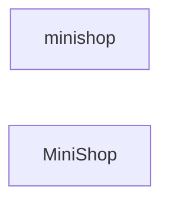
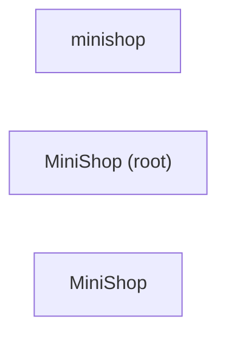

# 总览：三端路由矩阵

<!-- kb:breadcrumb -->
> monoshop
<!-- /kb:breadcrumb -->

> 由 facts 确定性生成（`kb compound`）。每个功能页覆盖一个 `route_id`，三端共享同一 pattern 与 deeplink。

| route_id | pattern | android | ios | 页面 |
|---|---|---|---|---|
| `MainActivity` | `MainActivity` | ✓ | — | [MainActivity](features/MainActivity.md) |
| `RootView` | `RootView` | — | ✓ | [RootView](features/RootView.md) |
| `cart` | `cart` | ✓ | ✓ | [购物车（cart）](features/cart.md) |
| `checkout` | `checkout` | ✓ | ✓ | [结算（checkout）](features/checkout.md) |
| `login` | `login` | ✓ | ✓ | [登录（login）](features/login.md) |
| `order_detail` | `order/{id}` | ✓ | ✓ | [订单详情（order_detail）](features/order_detail.md) |
| `product_detail` | `product/{id}` | ✓ | ✓ | [商品详情（product_detail）](features/product_detail.md) |
| `products` | `products` | ✓ | ✓ | [商品列表（products）](features/products.md) |

深链 scheme：`minishop`；测试态注入：`?token=<t>&cart=<sku,sku>`。

规模：14 条路由、22 个 testID、10 个接口调用点。三端差异见 [parity.md](parity.md)。机器可读：[routes.json](../facts/routes.json) · [testids.json](../facts/testids.json) · [apis.json](../facts/apis.json)

<!-- kb:children -->
## 子页面

| 页面 | 层级 | 重要度 | 摘要 |
|---|---|---|---|
| [MiniShop](shop-ios/overview.md) | 项目 | medium | MiniShop（swiftpm · ios）：2 个模块（MiniShop (root)、MiniShop），25 个核心符号。 |
| [minishop](shop-android/overview.md) | 项目 | low | minishop（gradle · android · android-app）：4 个功能簇（Cart view model、Login view model、Products view model、Data），24 个核心符号。 |
<!-- /kb:children -->

<!-- kb:diagram hash=328522928893 id=repo.projects -->

<!-- /kb:diagram -->

<!-- kb:diagram hash=4ca7055ff7d8 id=repo.deps -->

<!-- /kb:diagram -->
