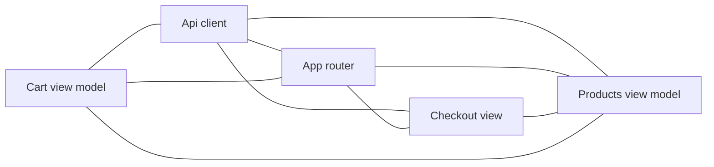

# MiniShop

<!-- kb:breadcrumb -->
> [monoshop](../../overview.md) › [MiniShop](../overview.md) › MiniShop
<!-- /kb:breadcrumb -->

> 由 `kb compound --llm template` 根据模块树（module_tree.json）、符号图与 facts 确定性生成；使用 agent 模式可获得更完整的叙述。

MiniShop（swift-executable）：5 个功能簇（Api client、App router、Checkout view、Cart view model 等），25 个核心符号。

<!-- kb:children -->
## 子页面

| 页面 | 层级 | 重要度 | 摘要 |
|---|---|---|---|
| [App router](app-router.md) | 功能簇 | high | App router：7 个核心符号（5 个 struct、1 个 class、1 个 enum），位于 5 个文件；主要符号 MiniShopApp、CartView、LoginView；路由 RootView, cart, login。 |
| [Api client](api-client.md) | 功能簇 | medium | Api client：6 个核心符号（3 个 class、2 个 struct、1 个 enum），位于 2 个文件；主要符号 LoginViewModel、APIClient、HTTPMethod。 |
| [Cart view model](cart-view-model.md) | 功能簇 | low | Cart view model：3 个核心符号（2 个 struct、1 个 class），位于 2 个文件；主要符号 CartViewModel、CartRequest、CartResponse。 |
| [Checkout view](checkout-view.md) | 功能簇 | low | Checkout view：5 个核心符号（5 个 struct），位于 4 个文件；主要符号 BackButton、CheckoutView、OrderDetailView；路由 checkout, order_detail。 |
| [Products view model](products-view-model.md) | 功能簇 | low | Products view model：4 个核心符号（3 个 struct、1 个 class），位于 4 个文件；主要符号 ProductDetailView、ProductsView、ProductsViewModel；路由 product_detail, products。 |
<!-- /kb:children -->

<!-- kb:diagram hash=03044090a9b7 id=shop-ios/mini-shop.clusters -->

<!-- /kb:diagram -->

<!-- kb:sources -->
Sources: `apps/shop-ios/MiniShop/App/MiniShopApp.swift` · `apps/shop-ios/MiniShop/Components/BackButton.swift` · `apps/shop-ios/MiniShop/Features/Cart/CartView.swift` · `apps/shop-ios/MiniShop/Features/Cart/CartViewModel.swift` · `apps/shop-ios/MiniShop/Features/Checkout/CheckoutView.swift` · `apps/shop-ios/MiniShop/Features/Login/LoginView.swift` · `apps/shop-ios/MiniShop/Features/Login/LoginViewModel.swift` · `apps/shop-ios/MiniShop/Features/Order/OrderDetailView.swift` · `apps/shop-ios/MiniShop/Features/Products/ProductDetailView.swift` · `apps/shop-ios/MiniShop/Features/Products/ProductsView.swift` · `apps/shop-ios/MiniShop/Features/Products/ProductsViewModel.swift` · `apps/shop-ios/MiniShop/Navigation/AppRouter.swift` … +2
<!-- /kb:sources -->
