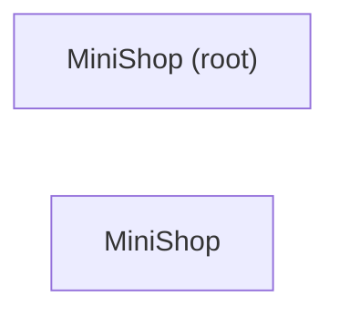

# MiniShop

<!-- kb:breadcrumb -->
> [monoshop](../overview.md) › MiniShop
<!-- /kb:breadcrumb -->

> 由 `kb compound --llm template` 根据模块树（module_tree.json）、符号图与 facts 确定性生成；使用 agent 模式可获得更完整的叙述。

MiniShop（swiftpm · ios）：2 个模块（MiniShop (root)、MiniShop），25 个核心符号。

<!-- kb:children -->
## 子页面

| 页面 | 层级 | 重要度 | 摘要 |
|---|---|---|---|
| [MiniShop](mini-shop/overview.md) | 模块 | medium | MiniShop（swift-executable）：5 个功能簇（Api client、App router、Checkout view、Cart view model 等），25 个核心符号。 |
| [MiniShop (root)](_root/overview.md) | 模块 | low | MiniShop (root)：0 个核心符号（），位于 1 个文件；主要符号 。 |
<!-- /kb:children -->

<!-- kb:diagram hash=fdd944c06111 id=shop-ios.deps -->

<!-- /kb:diagram -->
