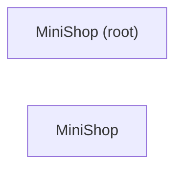

# MiniShop iOS 项目概览

<!-- kb:breadcrumb -->
> [monoshop](../overview.md) › MiniShop
<!-- /kb:breadcrumb -->

MiniShop iOS 端位于 `apps/shop-ios`，以 SwiftPM 组织，SwiftUI 实现。模块树中包含两个模块：根模块 `MiniShop (root)`（由 `apps/shop-ios/Package.swift` 定义）和 `MiniShop` 应用模块，共 25 个核心符号。

## 模块结构

| 模块 | 页面 | 说明 |
|---|---|---|
| MiniShop (root) | [_root/overview.md](_root/overview.md) | 包描述与根级配置，仅 1 个文件 |
| MiniShop | [mini-shop/index.md](mini-shop/index.md) | 应用主体，划分为 5 个功能簇 |

应用主体的功能簇：

- **App router**：`MiniShopApp`（`@main` 入口）、`AppRouter`、`RootView`，负责路由与深链分发，详见 [导航概念](../concepts/navigation.md)。
- **Api client**：网络请求封装，对应下文接口表。
- **Cart view model**：购物车状态（`CartViewModel`）。
- **Checkout view**：结算与订单详情视图。
- **Products view model**：商品列表与详情（`ProductsViewModel`）。

## 路由与深链

Deep-link scheme 为 `minishop`，路由事实来自 [facts/ios/routes.md](../../facts/ios/routes.md)：

| route_id | 路径模式 | 深链 | 视图 |
|---|---|---|---|
| `RootView` | `RootView` | — | 根视图（`AppRouter.swift`） |
| `products` | `products` | `minishop://products` | `ProductsView` |
| `product_detail` | `product/{id}` | `minishop://product/{id}` | `ProductDetailView` |
| `cart` | `cart` | `minishop://cart` | `CartView` |
| `checkout` | `checkout` | `minishop://checkout` | `CheckoutView` |
| `order_detail` | `order/{id}` | `minishop://order/{id}` | `OrderDetailView` |
| `login` | `login` | `minishop://login` | `LoginView` |

## 接口与数据流

iOS 端通过以下 HTTP 接口与后端交互（事实来自 [facts/ios/apis.md](../../facts/ios/apis.md)）：

| 方法 | 路径 | 调用位置 |
|---|---|---|
| GET | `/api/products` | `ProductsViewModel.loadProducts`（`Features/Products/ProductsViewModel.swift`） |
| GET | `/api/products/{id}` | `ProductsViewModel.loadProduct`（`Features/Products/ProductsViewModel.swift`） |
| POST | `/api/cart` | `CartViewModel.addItem`（`Features/Cart/CartViewModel.swift`） |
| POST | `/api/login` | `LoginViewModel.login`（`Features/Login/LoginViewModel.swift`） |
| POST | `/api/orders` | `CheckoutView.placeOrder`（`Features/Checkout/CheckoutView.swift`） |

数据流大致为：视图（SwiftUI `View`）→ 视图模型（`@MainActor final class ... : ObservableObject`）→ `Api client` → 后端接口。视图模型集中在 `Features/*/` 下的 `*ViewModel.swift` 文件中。

## 三端实现对照

本页仅覆盖 iOS 端的事实。Android 端的对应实现见 [shop-android/overview.md](../shop-android/overview.md)，三端差异汇总见 [parity.md](../parity.md)。

| 维度 | iOS 实现 |
|---|---|
| 工程形态 | SwiftPM，`apps/shop-ios/Package.swift` |
| UI 框架 | SwiftUI（视图均为 `struct ... : View`） |
| 状态管理 | `ObservableObject` 视图模型，标注 `@MainActor` |
| 导航 | `AppRouter`（`ObservableObject`）+ `RootView` |
| 深链 scheme | `minishop` |

## testID 与测试要点

testID 事实来自 [facts/ios/testids.md](../../facts/ios/testids.md)。动态 ID 按字面前缀记录（如 `product_item_`）。

| testID | route_id | 位置 |
|---|---|---|
| `login_username` | `login` | `Features/Login/LoginView.swift:11` |
| `login_password` | `login` | `Features/Login/LoginView.swift:12` |
| `login_submit` | `login` | `Features/Login/LoginView.swift:13` |
| `product_list` | `products` | `Features/Products/ProductsView.swift:8` |
| `product_item_` | `products` | `Features/Products/ProductsView.swift:9`（动态前缀） |
| `tab_cart` | `products` | `Features/Products/ProductsView.swift:14` |
| `add_to_cart` | `product_detail` | `Features/Products/ProductDetailView.swift:13` |
| `cart_checkout` | `cart` | `Features/Cart/CartView.swift:11` |
| `checkout_submit` | `checkout` | `Features/Checkout/CheckoutView.swift:9` |
| `order_status` | `order_detail` | `Features/Order/OrderDetailView.swift:9` |
| `nav_back` | — | `Components/BackButton.swift:8` |

测试要点：

- 登录流程依次使用 `login_username`、`login_password`、`login_submit`。
- 商品列表以 `product_list` 定位容器，单项使用 `product_item_` 前缀匹配。
- 下单链路为 `products` → `product_detail`（`add_to_cart`）→ `cart`（`cart_checkout`）→ `checkout`（`checkout_submit`）→ `order_detail`（`order_status`）。
- 返回按钮统一为 `nav_back`，定义在共享组件中，参见 [共享组件概念](../concepts/shared-components.md)。

## 相关页面

- [项目总览](../overview.md)
- [MiniShop 应用模块](mini-shop/index.md)
- [MiniShop (root) 模块](_root/overview.md)
- [Android 端概览](../shop-android/overview.md)
- [三端对照](../parity.md)
- [导航概念](../concepts/navigation.md)
- [共享组件概念](../concepts/shared-components.md)

<!-- kb:children -->
## 子页面

| 页面 | 层级 | 重要度 | 摘要 |
|---|---|---|---|
| [MiniShop](mini-shop/overview.md) | 模块 | medium | MiniShop（swift-executable）：5 个功能簇（Api client、App router、Checkout view、Cart view model 等），25 个核心符号。 |
| [MiniShop (root)](_root/overview.md) | 模块 | low | MiniShop (root)：0 个核心符号（），位于 1 个文件；主要符号 。 |
<!-- /kb:children -->

<!-- kb:diagram hash=fdd944c06111 id=shop-ios.deps -->

<!-- /kb:diagram -->
