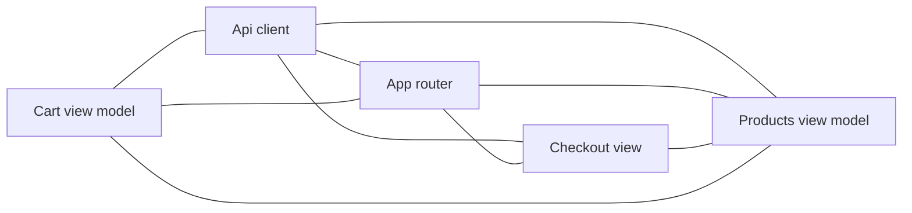

# MiniShop（iOS 模块）

<!-- kb:breadcrumb -->
> [monoshop](../../overview.md) › [MiniShop](../overview.md) › MiniShop
<!-- /kb:breadcrumb -->

## 概述

`MiniShop` 是 iOS 端的 Swift 可执行模块（swift-executable），与 Android 端 `shop-android` 对应同一套购物流程：商品列表与详情、购物车、登录、结算与订单详情。模块由 5 个功能簇组成，共 25 个核心符号：

| 功能簇 | 子页面 | 职责 |
|---|---|---|
| App router | [app-router.md](app-router.md) | 应用入口、根视图与路由、深链分发 |
| Api client | [api-client.md](api-client.md) | HTTP 请求与登录相关的视图模型 |
| Checkout view | [checkout-view.md](checkout-view.md) | 结算与订单详情视图、通用返回按钮 |
| Cart view model | [cart-view-model.md](cart-view-model.md) | 购物车视图模型与请求/响应结构 |
| Products view model | [products-view-model.md](products-view-model.md) | 商品列表、商品详情视图与视图模型 |

> 本页由确定性模块树信息整理，功能细节以各子页面与 `facts/ios/` 为准。

## 路由与深链

深链 scheme 为 `minishop`。路由事实来自 [`facts/ios/routes.md`](../../../facts/ios/routes.md)，iOS 端共 7 个 route_id：

| route_id | 路径模式 | 深链 | 对应视图 |
|---|---|---|---|
| `RootView` | `RootView` | 无 | `ios://MiniShop/Navigation/AppRouter.swift#RootView` |
| `products` | `products` | `minishop://products` | `ios://MiniShop/Features/Products/ProductsView.swift#ProductsView` |
| `product_detail` | `product/{id}` | `minishop://product/{id}` | `ios://MiniShop/Features/Products/ProductDetailView.swift#ProductDetailView` |
| `cart` | `cart` | `minishop://cart` | `ios://MiniShop/Features/Cart/CartView.swift#CartView` |
| `checkout` | `checkout` | `minishop://checkout` | `ios://MiniShop/Features/Checkout/CheckoutView.swift#CheckoutView` |
| `order_detail` | `order/{id}` | `minishop://order/{id}` | `ios://MiniShop/Features/Order/OrderDetailView.swift#OrderDetailView` |
| `login` | `login` | `minishop://login` | `ios://MiniShop/Features/Login/LoginView.swift#LoginView` |

## 三端实现对照

| 功能 | iOS 实现（符号 ID） | Android 功能页 |
|---|---|---|
| 登录 | `ios://MiniShop/Features/Login/LoginView.swift#LoginView`，`ios://MiniShop/Features/Login/LoginViewModel.swift#LoginViewModel.login` | [login](../../features/login.md) |
| 商品列表 | `ios://MiniShop/Features/Products/ProductsView.swift#ProductsView`，`ios://MiniShop/Features/Products/ProductsViewModel.swift#ProductsViewModel.loadProducts` | [products](../../features/products.md) |
| 商品详情 | `ios://MiniShop/Features/Products/ProductDetailView.swift#ProductDetailView`，`ios://MiniShop/Features/Products/ProductsViewModel.swift#ProductsViewModel.loadProduct` | [product_detail](../../features/product_detail.md) |
| 购物车 | `ios://MiniShop/Features/Cart/CartView.swift#CartView`，`ios://MiniShop/Features/Cart/CartViewModel.swift#CartViewModel.addItem` | [cart](../../features/cart.md) |
| 结算 | `ios://MiniShop/Features/Checkout/CheckoutView.swift#CheckoutView`，`ios://MiniShop/Features/Checkout/CheckoutView.swift#CheckoutView.placeOrder` | [checkout](../../features/checkout.md) |
| 订单详情 | `ios://MiniShop/Features/Order/OrderDetailView.swift#OrderDetailView` | [order_detail](../../features/order_detail.md) |
| 根视图与路由 | `ios://MiniShop/Navigation/AppRouter.swift#RootView` | [RootView](../../features/RootView.md) |

## 接口与数据流

iOS 端直接在视图模型或视图中发起 HTTP 调用，事实来自 [`facts/ios/apis.md`](../../../facts/ios/apis.md)：

| 方法 | 路径 | 调用方符号 |
|---|---|---|
| POST | `/api/login` | `ios://MiniShop/Features/Login/LoginViewModel.swift#LoginViewModel.login` |
| GET | `/api/products` | `ios://MiniShop/Features/Products/ProductsViewModel.swift#ProductsViewModel.loadProducts` |
| GET | `/api/products/{id}` | `ios://MiniShop/Features/Products/ProductsViewModel.swift#ProductsViewModel.loadProduct` |
| POST | `/api/cart` | `ios://MiniShop/Features/Cart/CartViewModel.swift#CartViewModel.addItem` |
| POST | `/api/orders` | `ios://MiniShop/Features/Checkout/CheckoutView.swift#CheckoutView.placeOrder` |

典型购物路径：登录（`/api/login`）→ 浏览商品（`/api/products`、`/api/products/{id}`）→ 加入购物车（`/api/cart`）→ 结算下单（`/api/orders`）。

## testID 与测试要点

testID 事实来自 [`facts/ios/testids.md`](../../../facts/ios/testids.md)，UI 自动化可直接依赖这些标识：

| testID | route_id | 位置 |
|---|---|---|
| `login_username` | `login` | `apps/shop-ios/MiniShop/Features/Login/LoginView.swift:11` |
| `login_password` | `login` | `apps/shop-ios/MiniShop/Features/Login/LoginView.swift:12` |
| `login_submit` | `login` | `apps/shop-ios/MiniShop/Features/Login/LoginView.swift:13` |
| `product_list` | `products` | `apps/shop-ios/MiniShop/Features/Products/ProductsView.swift:8` |
| `product_item_`（动态前缀） | `products` | `apps/shop-ios/MiniShop/Features/Products/ProductsView.swift:9` |
| `tab_cart` | `products` | `apps/shop-ios/MiniShop/Features/Products/ProductsView.swift:14` |
| `add_to_cart` | `product_detail` | `apps/shop-ios/MiniShop/Features/Products/ProductDetailView.swift:13` |
| `cart_checkout` | `cart` | `apps/shop-ios/MiniShop/Features/Cart/CartView.swift:11` |
| `checkout_submit` | `checkout` | `apps/shop-ios/MiniShop/Features/Checkout/CheckoutView.swift:9` |
| `order_status` | `order_detail` | `apps/shop-ios/MiniShop/Features/Order/OrderDetailView.swift:9` |
| `nav_back` | （无） | `apps/shop-ios/MiniShop/Components/BackButton.swift:8` |

测试要点：

- 动态 ID `product_item_` 只记录字面前缀，断言时需拼接商品 id。
- `nav_back` 属于共享组件 `BackButton`，不绑定单一路由，参见 [共享组件](../../concepts/shared-components.md)。
- 导航相关的断言可参考 [导航概念](../../concepts/navigation.md)。

## 相关页面

- 上级：[shop-ios 索引](../index.md)，[monoshop 总览](../../overview.md)
- 子页面：[App router](app-router.md)、[Api client](api-client.md)、[Checkout view](checkout-view.md)、[Cart view model](cart-view-model.md)、[Products view model](products-view-model.md)
- 功能页：[login](../../features/login.md)、[products](../../features/products.md)、[product_detail](../../features/product_detail.md)、[cart](../../features/cart.md)、[checkout](../../features/checkout.md)、[order_detail](../../features/order_detail.md)、[RootView](../../features/RootView.md)
- 概念：[导航](../../concepts/navigation.md)、[共享组件](../../concepts/shared-components.md)

<!-- kb:children -->
## 子页面

| 页面 | 层级 | 重要度 | 摘要 |
|---|---|---|---|
| [App router](app-router.md) | 功能簇 | high | App router：7 个核心符号（5 个 struct、1 个 class、1 个 enum），位于 5 个文件；主要符号 MiniShopApp、CartView、LoginView；路由 RootView, cart, login。 |
| [Api client](api-client.md) | 功能簇 | medium | Api client：6 个核心符号（3 个 class、2 个 struct、1 个 enum），位于 2 个文件；主要符号 LoginViewModel、APIClient、HTTPMethod。 |
| [Cart view model](cart-view-model.md) | 功能簇 | low | Cart view model：3 个核心符号（2 个 struct、1 个 class），位于 2 个文件；主要符号 CartViewModel、CartRequest、CartResponse。 |
| [Checkout view](checkout-view.md) | 功能簇 | low | Checkout view：5 个核心符号（5 个 struct），位于 4 个文件；主要符号 BackButton、CheckoutView、OrderDetailView；路由 checkout, order_detail。 |
| [Products view model](products-view-model.md) | 功能簇 | low | Products view model：4 个核心符号（3 个 struct、1 个 class），位于 4 个文件；主要符号 ProductDetailView、ProductsView、ProductsViewModel；路由 product_detail, products。 |
<!-- /kb:children -->

<!-- kb:diagram hash=03044090a9b7 id=shop-ios/mini-shop.clusters -->

<!-- /kb:diagram -->

<!-- kb:sources -->
Sources: `apps/shop-ios/MiniShop/App/MiniShopApp.swift` · `apps/shop-ios/MiniShop/Components/BackButton.swift` · `apps/shop-ios/MiniShop/Features/Cart/CartView.swift` · `apps/shop-ios/MiniShop/Features/Cart/CartViewModel.swift` · `apps/shop-ios/MiniShop/Features/Checkout/CheckoutView.swift` · `apps/shop-ios/MiniShop/Features/Login/LoginView.swift` · `apps/shop-ios/MiniShop/Features/Login/LoginViewModel.swift` · `apps/shop-ios/MiniShop/Features/Order/OrderDetailView.swift` · `apps/shop-ios/MiniShop/Features/Products/ProductDetailView.swift` · `apps/shop-ios/MiniShop/Features/Products/ProductsView.swift` · `apps/shop-ios/MiniShop/Features/Products/ProductsViewModel.swift` · `apps/shop-ios/MiniShop/Navigation/AppRouter.swift` … +2
<!-- /kb:sources -->
